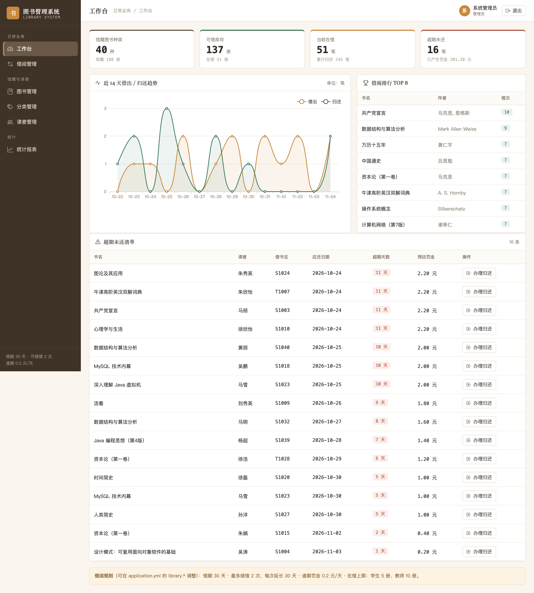
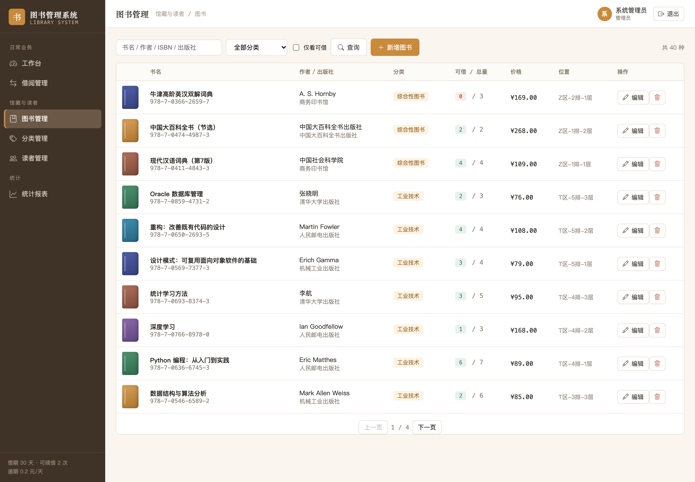
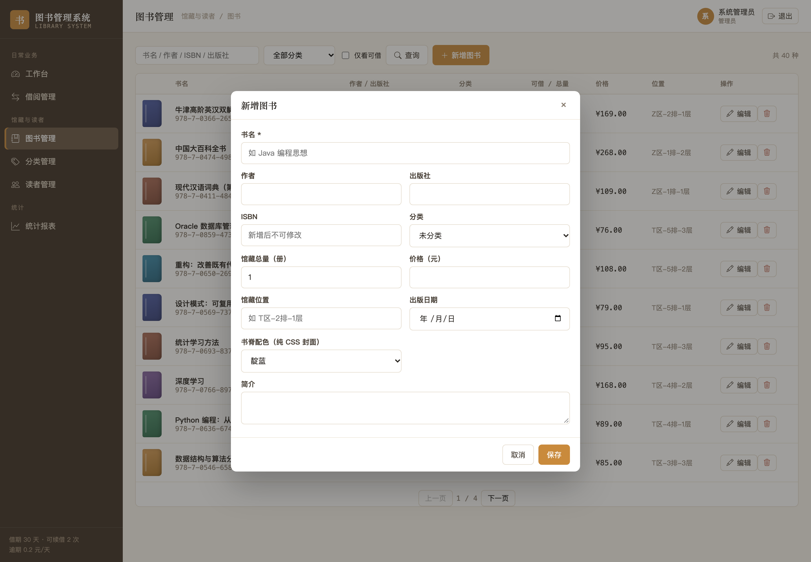
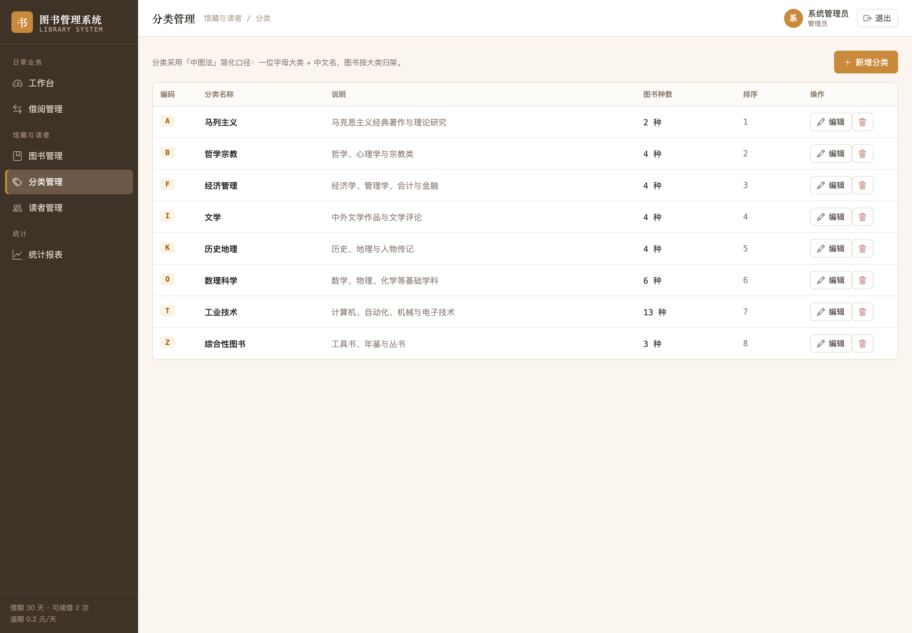
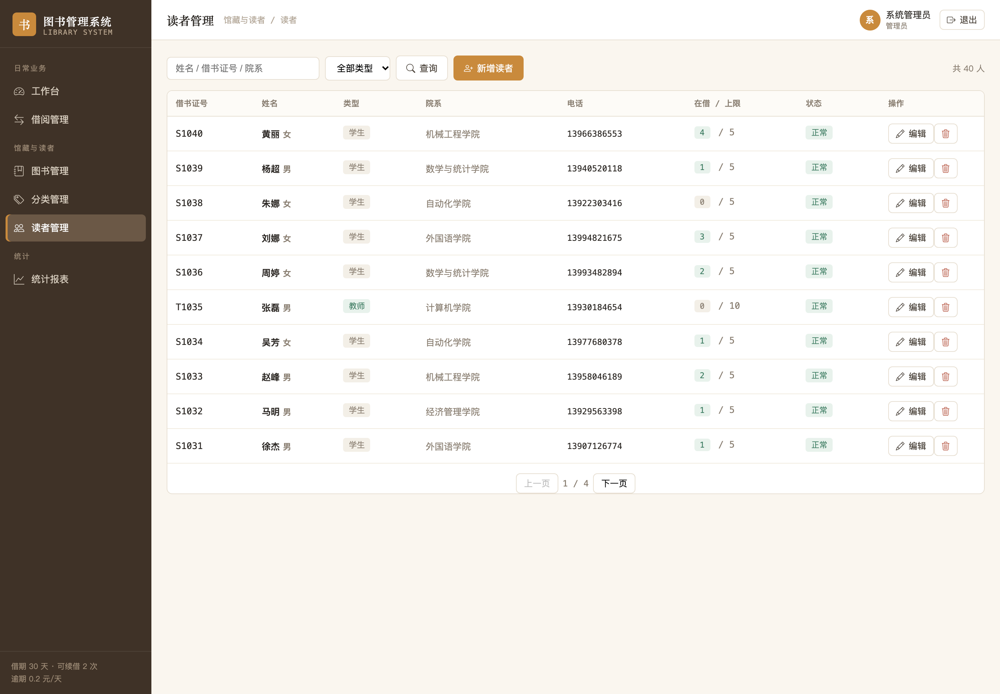
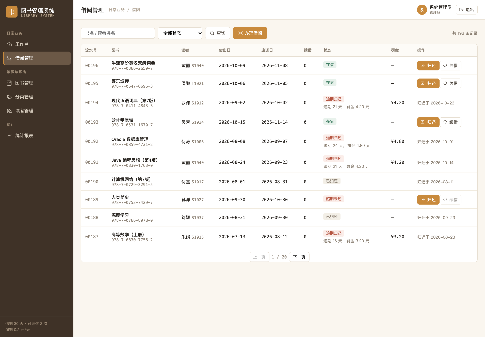
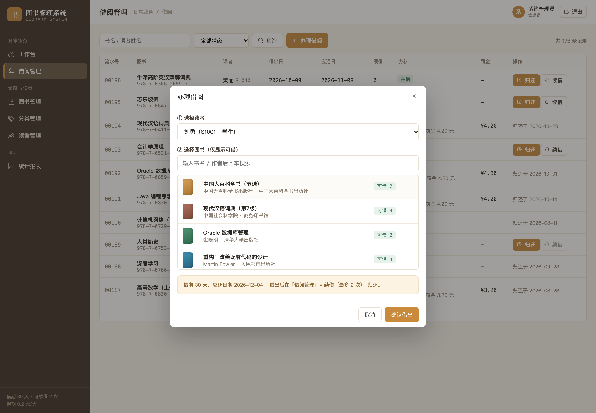
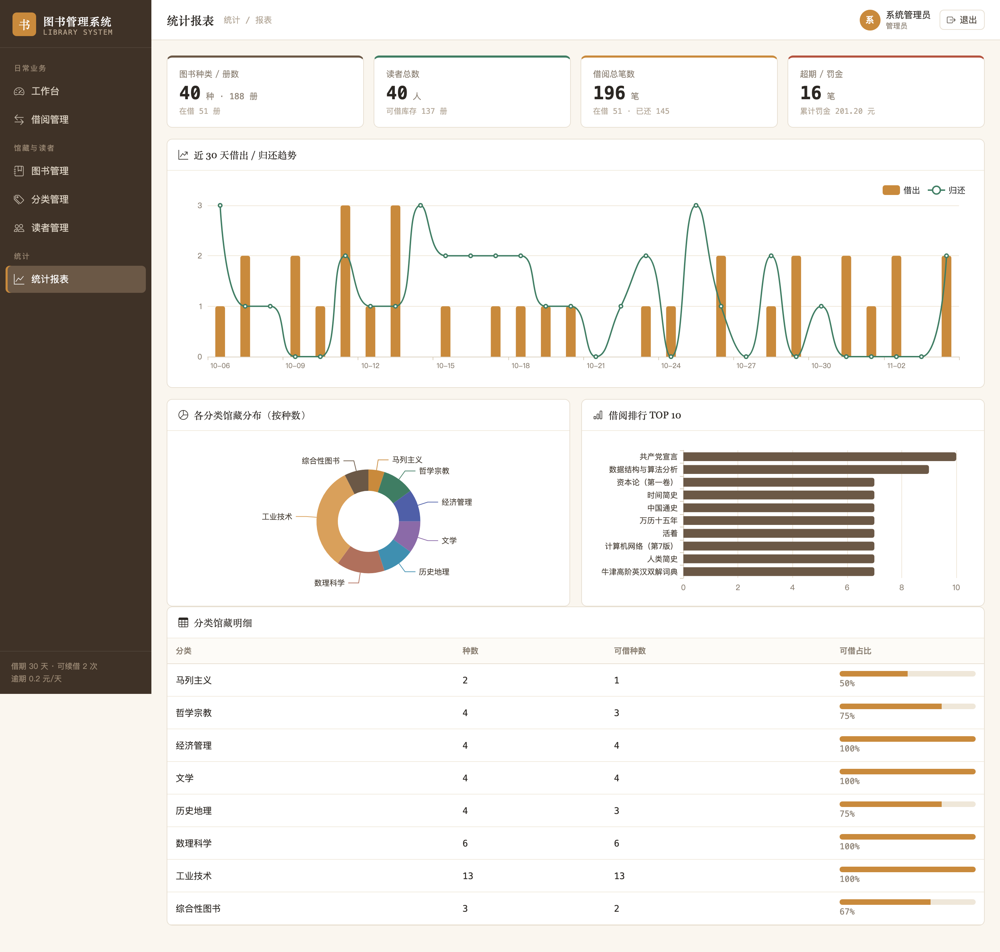
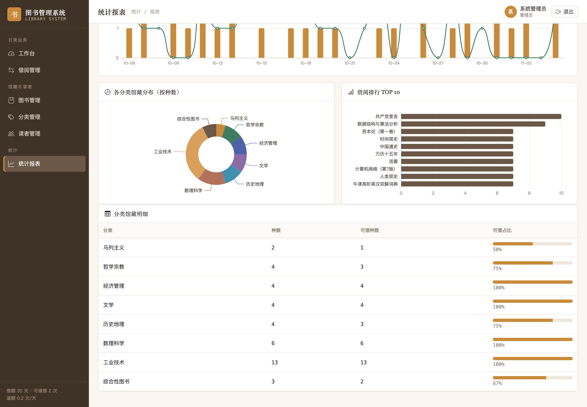
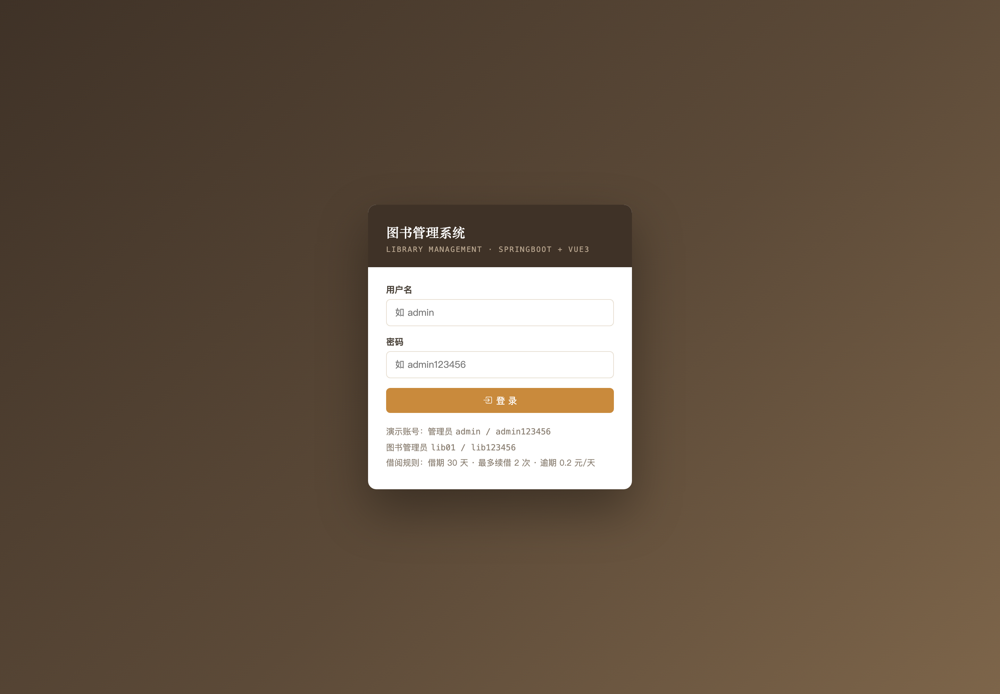

# 013 基于 SpringBoot 的图书管理系统-设计展示

> **代码有偿获取 可接受定制 微信联系方式: csbysj2020 或 ACE2487，备注(BS)**

> **完整源码与全套文档 · 在线自助获取 >>> [https://mbd.pub/o/bread/YZaWlJ5ybA==](https://mbd.pub/o/bread/YZaWlJ5ybA==)**

> **成品页（功能介绍 / 更多选题）>>> [https://bishe.suilang.net/products/springboot-library](https://bishe.suilang.net/products/springboot-library)**

> 

> 

## 视频

> **点击查看 >>> [https://www.bilibili.com/video/BV1gbxf6UEnw/](https://www.bilibili.com/video/BV1gbxf6UEnw/)**

## 项目简介

面向高校图书馆日常业务的图书管理系统：图书编目与分类、读者管理、借出/归还/续借、库存联动、逾期罚金结算与借阅统计。后端 Spring Boot 3 + Spring Data JPA 分层架构，前端 Vue 3 无需构建，默认 H2 文件库免安装、可一键切换 MySQL。论文围绕「馆藏总量 = 在借册数 + 可借册数」的库存一致性与事务设计展开。

图书借阅是高校图书馆最基础也最频繁的日常业务，人工登记存在库存对不上、逾期难管理、统计靠人算等问题。

针对这些问题，本项目设计并实现了一套基于 SpringBoot 的图书管理系统，把「编目—借阅—归还—续借—统计」串成业务闭环。

系统后端采用 Spring Boot 3.2.5 与 Spring Data JPA，按 Controller / Service / Repository / Entity 四层组织代码，以统一响应结构 `{code, message, data}` 规范对外契约，并通过全局异常处理把业务错误与参数校验错误转成可读提示；登录采用 HttpSession 保存会话、自定义 `AuthInterceptor` 统一拦截，未登录访问接口返回 401、页面跳转登录，未引入 Spring Security 以降低依赖与学习成本。

本仓库为**设计展示**：包含项目说明、技术架构、实验结果与运行截图；完整源码、任务书、开题报告、毕业论文与使用说明可通过上方链接自助获取，成品页可查看更多选题，也可联系微信咨询定制。

## 功能特性

1. 分层架构：Controller / Service / Repository / Entity 四层，统一响应 {code,message,data} 与全局异常处理

2. 库存一致性：馆藏总量 = 在借 + 可借，借出减、归还加、编辑总量同步可借数，全部在 @Transactional 事务内完成

3. 借出四重校验：读者未冻结、在借未达上限、库存充足、同一读者未重复借同一本未还图书

4. 归还结算：按 0.2 元/天计算逾期天数与罚金并写入记录；续借最多 2 次且超期不可续借

5. 双数据库：MySQL 8.0 为部署口径，交付默认 H2 文件库（免安装），--spring.profiles.active=mysql 一键切换

6. 六个业务页面：工作台、图书、分类、读者、借阅、统计；前端本地 Vue 3 全局构建，无需 Node 打包

7. 统计报表：总览指标、近 30 天借还趋势、分类馆藏分布、借阅排行 TOP 10 与分类明细

8. 登录与会话：口令 SHA-256 加盐摘要，HttpSession + 自定义 AuthInterceptor 统一拦截（未引入 Spring Security）

## 技术架构

| 项目 | 说明 |
| --- | --- |
| 编程语言 | Java 17（编译目标；JDK 20 运行正常） |
| 后端框架 | Spring Boot 3.2.5 + Spring Data JPA / Hibernate |
| 参数校验 | Jakarta Bean Validation |
| 构建工具 | Maven 3.6+ |
| 前端 | Vue 3（本地 vue.global.prod.js，无需 Node 构建）+ Bootstrap Icons + ECharts 5 |
| 数据库 | MySQL 8.0（交付默认 H2 文件库，免安装，可一键切换） |
| 会话与安全 | HttpSession + 自定义 AuthInterceptor；口令 SHA-256 加盐摘要 |
| 操作系统 | Windows / macOS / Linux |
| 启动方式 | 双击一键脚本，或 java -jar library-system.jar |

## 目录结构

以下为完整交付版的结构（本仓库仅作设计展示）：

```
springboot-library/
├── 任务书/
│   └── 毕业设计任务书.docx
├── 开题报告/
│   └── 毕业设计开题报告.docx
├── 最终论文/
│   ├── 图/
│   │   ├── 图3-1_系统用例图.png
│   │   ├── 图4-1_系统架构图.png
│   │   ├── 图4-2_功能模块图.png
│   │   ├── 图4-3_借阅业务流程图.png
│   │   └── 图4-4_数据库ER图.png
│   └── 基于SpringBoot的图书管理系统设计.docx
├── 源码/
│   ├── .mvn/
│   │   └── wrapper/
│   ├── data/
│   │   └── library.mv.db
│   ├── src/
│   │   ├── main/
│   │   └── test/
│   ├── mvnw
│   ├── mvnw.cmd
│   ├── pom.xml
│   ├── README.md
│   ├── settings.xml
│   ├── 启动系统.bat
│   └── 启动系统.command
├── 演示截图/
│   ├── 013-01-login.png
│   ├── 013-02-dashboard.png
│   ├── 013-03-books.png
│   ├── 013-04-book-add.png
│   ├── 013-05-categories.png
│   ├── 013-06-readers.png
│   ├── 013-07-borrows.png
│   ├── 013-08-borrow-modal.png
│   ├── 013-09-stats.png
│   └── 013-10-stats-detail.png
├── 交付清单.md
├── 系统使用与二次开发说明.docx
└── 系统使用与二次开发说明.md
```

## 数据与实验结论

- 数据库以 MySQL 8.0 为部署口径，同时提供 H2 文件库配置使系统解压即可运行，通过 `--spring.profiles.active=mysql` 一键切换，两种数据库共用同一套 JPA 映射与业务代码。
- 业务上实现了图书与分类的增删改查与多维检索、读者的借书证校验与在借上限、借出（读者状态 / 上限 / 库存 / 重复借阅四重校验）、归还（按 0.2 元/天结算逾期罚金）、续借（最多 2 次且超期不可续借），以及总览指标、近 30 天借还趋势、分类馆藏分布、借阅排行与超期清单等统计。
- 前端不引入构建工具，使用本地 Vue 3 全局构建版本实现六个页面并复用公共布局与请求封装。
- 测试数据规模为 8 个分类、40 种图书（馆藏 188 册）、40 位读者、196 条借阅记录，服务启动约 2.6 秒；功能测试覆盖借还流程与库存等式，边界测试验证了超借、删除有未还记录的图书与读者等场景。

## 交付内容

1. 完整源码（已跑通，Spring Boot 工程 + 六个前端页面 + 前端资源）
2. Maven Wrapper 与一键启动脚本（Windows / macOS；缺 jar 时自动构建，首次联网下载依赖）
3. H2 演示数据库（8 个分类 / 40 种图书 / 40 位读者 / 约 196 条借阅记录）与 MySQL 配置
4. 毕业设计任务书（Word）
5. 开题报告（Word）
6. 毕业论文（Word，七章制，含库存一致性与事务设计、测试用例）
7. 系统使用与二次开发说明（Word + md）
8. 10 张系统运行截图

## 常见问题

**项目能直接跑起来吗？**

能。交付包内带已构建的可执行 jar 与 H2 演示数据库，安装 JDK 17+ 后双击一键脚本即可启动（约 2.6 秒），首次启动自动建表并写入演示数据。

**为什么论文写 MySQL，交付却是 H2？**

论文与部署口径是 MySQL 8.0，交付默认 H2 文件库是为了让系统免安装、解压即可运行。两者共用同一套 JPA 映射与业务代码，加 --spring.profiles.active=mysql 即可切换，无需改动代码。

**库存是怎么保证不出错的？**

系统约定「馆藏总量 = 在借册数 + 可借册数」：借出减一、归还加一、编辑总量时按差值同步可借数且不得小于在借数，这些变更全部收敛在带 @Transactional 的 Service 方法里，避免出现「记录写了、库存没减」。

**借书有哪些限制？**

借出前做四重校验：读者未冻结、在借未达上限（学生 5 册、教师 10 册）、库存充足、同一读者未重复借同一本未还图书；借期 30 天，最多续借 2 次，超期不可续借。

**逾期罚金怎么算？**

归还时按应还日与归还日计算逾期天数，以 0.2 元/天结算并写入借阅记录（可在 application.yml 的 library.fine-per-day 调整）。

**为什么不用 Spring Security？**

本项目只有两种角色、接口数量少，HttpSession + 自定义拦截器已能覆盖需求，依赖更少、启动更快、对二次开发更友好。如需更强安全能力，把拦截器替换为 SecurityFilterChain 即可，业务代码无需改动。

## 截图











